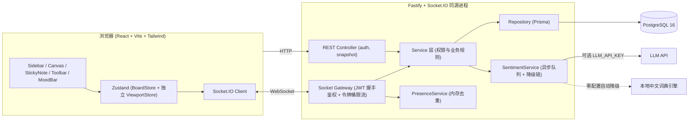

# 实时评论墙（Real-time Comment Wall）

鹰眼智能 2027 校园招聘代码考核完整实现，覆盖**全部基础需求（1–7）与全部拓展需求（情绪自动染色 / 情绪概览 / 智能整理）**。完整架构设计与决策记录见 [docs/architecture.md](docs/architecture.md)。

## 功能亮点

- **认证与权限隔离**：账号密码注册/登录（`bcrypt` + `JWT`），登录页提供一键切换演示账号；后端强制校验资源所有权，作者仅可编辑、拖动与软删除自己的卡片，对他人卡片仅可读与点赞（数据库联合主键防重复点赞、服务端严格禁止自赞）。
- **虚拟世界画布与多端实时同步**：基于逻辑世界坐标 `(x, y, zIndex, rotation)` + GPU 合成层平移与鼠标锚点缩放，不同屏幕分辨率下相对排布一致；拖拽中以 40ms 节流纯内存广播（不写库），松手原子落库并递增 `version` 乐观锁；支持断线自动重连快照对账与手动一键同步。
- **在线状态去重**：按 `userId` 维护连接集合，同一用户多标签页只计为在线一人，侧边栏当前用户置顶。
- **异步情绪识别与策略降级**：发帖/编辑不阻塞，后台内存队列（并发 ≤ 3、同评论防抖）优先调用 OpenAI 兼容协议 LLM 分类（3 秒超时），未配置 `LLM_API_KEY` 或网络异常时无感降级为内置职场增强中文情感词典引擎，完成后全员推送变色并实时刷新顶部 `MoodBar`。
- **全局无损智能整理**：底部一键切换 `free ↔ organized` 全员实时同步，通过共享纯函数按正向/中性/负面三列排布且不破坏每张卡片的原始自由坐标，关闭后平滑动画飞回原位。

## 系统架构



## 一键部署与验收（推荐）

```bash
docker compose up -d --build
```

容器启动后自动执行 Prisma 迁移、写入演示账号与示例贴纸，并由 Fastify 同源托管前端静态资源：

1. 浏览器访问 `http://localhost:3000`，点击演示账号 **Alice** 一键登录。
2. 新开一个无痕窗口访问 `http://localhost:3000`，点击 **Bob** 一键登录。
3. 即可双屏直观验收：
   - 左侧在线列表实时更新；
   - 在画布空白处点击发布贴纸，对端秒级同步并异步变色、刷新顶部情绪概览；
   - 切换至「拖动」模式拖动自己的贴纸，对端可见丝滑移动过程与“正在拖动”徽标，拖动他人卡片将被拦截；
   - 切换至「点赞」模式或直接点击他人卡片爱心点赞，尝试给自己卡片点赞会被拦截；
   - 点击底部「✨ 智能整理」，双端同步平滑切换至三列整理视图，再次点击无损飞回原自由坐标。

> 内置演示账号：`alice` / `bob` / `carol`，密码均为 `demo123`。
> 若希望启用大模型情绪识别，启动前设置环境变量 `LLM_API_KEY`（以及可选 `LLM_BASE_URL`、`LLM_MODEL`）；留空即开箱使用内置中文情感词典引擎。

## 本地开发与测试

```bash
cp .env.example .env
docker compose up -d db          # 仅启动 PostgreSQL（宿主机端口 5433）
pnpm install
pnpm --filter @wall/server db:deploy
pnpm db:seed

# 启动开发服务
pnpm dev:server                  # Fastify + Socket.IO (:3000)
pnpm dev:web                     # Vite (:5173，已代理 /api 与 /socket.io)

# 类型检查、测试与生产构建
pnpm typecheck
pnpm test
pnpm build
```

## 目录结构

```text
pro_offer/
├─ apps/
│  ├─ web/            # React 18 + Vite 6 + Tailwind CSS 4 + Zustand 5
│  └─ server/         # Fastify 5 + Socket.IO 4 + Prisma 6 (controllers/gateways/services/repositories/sentiment)
├─ packages/shared/   # 前后端共享类型、Zod 校验、Socket 事件常量、智能整理与情绪统计纯函数
├─ docs/architecture.md
├─ agent.md           # 工程红线与协作约定
├─ Dockerfile
└─ docker-compose.yml
```

## 核心设计取舍

1. **拖拽瞬态广播与落库解耦**：拖动过程高频发送 `comment:drag`，服务端仅做内存所有权校验并广播 `comment:dragging`，零数据库写入；松手时发送 `comment:move` 带 `version` 乐观锁落库，兼顾 60fps 协同临场感与数据库吞吐。
2. **视口与业务状态分离**：前端将 `offsetX/offsetY/scale` 放入独立 `useViewportStore`，画布卡片层不订阅视口变化，平移缩放时不触发上百张贴纸重渲染。
3. **无损全局智能整理**：将 `layoutMode` 作为全局同步状态，整理布局坐标由 `@wall/shared` 纯函数确定性实时计算，不覆写数据库中他人摆放的自由坐标，兼顾“全员所见一致”与“不篡改他人卡片位置”。
4. **水平扩展演进路径**：当前单机内存维护在线列表与情绪队列；多实例扩展时可无缝接入 `@socket.io/redis-adapter`、Redis Hash + TTL 在线态与 BullMQ 异步队列。

## 里程碑进度

- [x] M1：Monorepo 骨架、Prisma 模型与迁移、注册/登录/me 认证、Docker Compose
- [x] M2：登录页、虚拟世界画布（平移/缩放）、创建/编辑/拖动/删除、在线列表、实时同步
- [x] M3：点赞事务与防自赞、权限细节、重连对账强化、按原型图还原视觉样式
- [x] M4：异步情绪识别引擎（LLM + 本地词典降级）、MoodBar 情绪概览、智能整理全局无损切换
- [x] M5：Vitest 单元测试、双端 Socket 集成测试、示例数据与完整文档、Docker 全量验收
