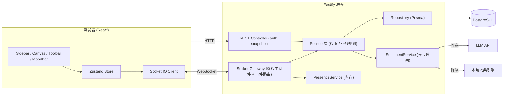
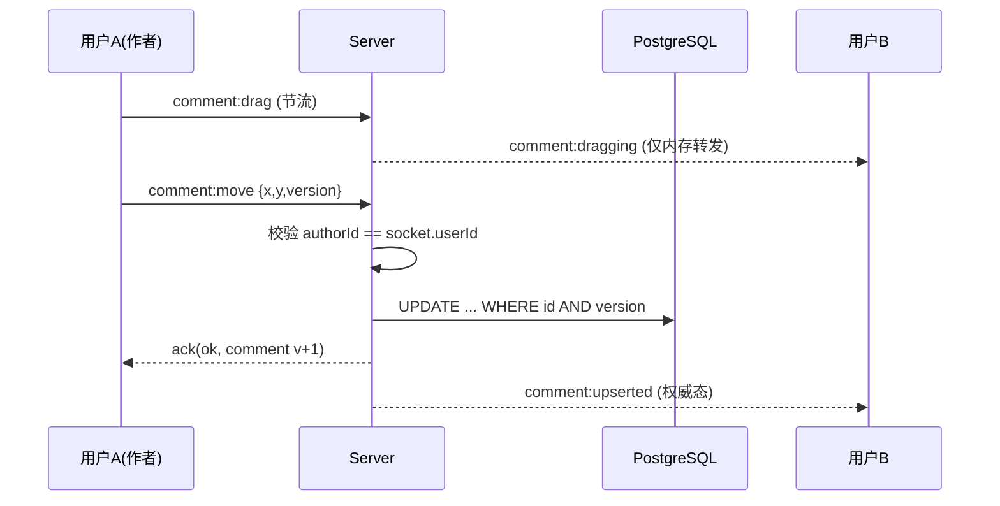
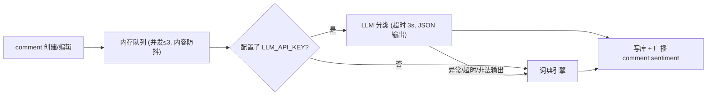

# 实时评论墙 · 架构方案

> 鹰眼智能 2027 校招代码考核。范围：基础需求 1–7 + 全部拓展需求（情绪染色 / 情绪概览 / 智能整理）。

## 1. 决策总览

| 维度 | 决策 | 核心理由 |
|---|---|---|
| 技术栈 | 全栈 TypeScript：React + Vite + Tailwind / Fastify + Socket.IO | 前后端共享类型契约，实时生态成熟 |
| 工程结构 | pnpm Monorepo：`apps/web`、`apps/server`、`packages/shared` | 事件名、DTO、Zod 校验只定义一次 |
| 认证 | 账号密码（bcrypt）+ JWT；登录页"一键演示账号" | 鉴权严谨，同时方便评审双开窗口验收 |
| 画布 | 虚拟世界坐标（x, y, zIndex, rotation）+ 平移/缩放 | 不同分辨率下相对位置完全一致 |
| 实时同步 | 拖拽中节流广播（不落库）+ 松手落库并广播权威状态 + 重连全量对账 | 体验流畅，写库压力小，不会漂移 |
| 情绪识别 | 异步执行；LLM（OpenAI 兼容协议）优先，失败时降级到本地中文词典引擎 | 准确率高，零配置也能用 |
| 智能整理 | 全局同步 `layoutMode: free ↔ organized`，不改原始坐标 | 全员一致，又不覆盖别人的卡片位置 |
| 存储与部署 | PostgreSQL + Prisma；在线状态存内存（预留 Redis Adapter）；Docker Compose | 事务强一致，一条命令启动，后续可水平扩展 |
| 权限 | 每人每卡限赞一次（可取消），禁止给自己点赞；作者可编辑 / 软删除 | 对应题目第 7 条 |

## 2. 系统架构



分层约束：Gateway / Controller 只负责协议解析与 Zod 校验；**所有权限判断放在 Service 层**，这样 REST 和 Socket 共用同一套规则，避免某一侧漏掉校验。

## 3. 目录结构

```text
pro_offer/
├─ apps/
│  ├─ web/            # React + Vite + Tailwind
│  │  └─ src/{pages,components/canvas,components/sidebar,stores,hooks,lib/socket.ts}
│  └─ server/         # Fastify + Socket.IO
│     ├─ src/{controllers,gateways,services,repositories,sentiment,plugins,config}
│     └─ prisma/schema.prisma
├─ packages/shared/   # 事件常量、DTO 类型、Zod schema、布局算法
├─ docker-compose.yml
└─ README.md
```

> 把"智能整理布局算法"放在 `shared` 中，前后端用同一个纯函数计算位置，保证所有客户端渲染结果一致。

## 4. 数据模型（Prisma）

```prisma
model User {
  id           String   @id @default(cuid())
  username     String   @unique
  passwordHash String
  nickname     String
  avatarColor  String
  createdAt    DateTime @default(now())
  comments     Comment[]
  likes        Like[]
}

model Comment {
  id          String    @id @default(cuid())
  authorId    String
  author      User      @relation(fields: [authorId], references: [id])
  content     String    @db.VarChar(500)
  x           Float
  y           Float
  zIndex      Int       @default(0)
  rotation    Float     @default(0)      // 贴纸轻微倾斜，还原手贴质感
  sentiment   Sentiment @default(PENDING)
  sentimentBy String?                     // llm | lexicon，便于排查
  version     Int       @default(1)       // 乐观锁 + 客户端丢弃过期事件
  likeCount   Int       @default(0)       // 冗余计数，避免每次快照 COUNT
  deletedAt   DateTime?
  createdAt   DateTime  @default(now())
  updatedAt   DateTime  @updatedAt
  likes       Like[]
  @@index([deletedAt])
}

model Like {
  userId    String
  commentId String
  user      User    @relation(fields: [userId], references: [id])
  comment   Comment @relation(fields: [commentId], references: [id])
  createdAt DateTime @default(now())
  @@id([userId, commentId])   // 数据库层兜底"每人限赞一次"，防并发重复点赞
}

model BoardState {
  id         Int      @id @default(1)    // 单墙单行
  layoutMode String   @default("free")
  updatedAt  DateTime @updatedAt
}

enum Sentiment { PENDING POSITIVE NEUTRAL NEGATIVE }
```

## 5. 实时协议（Socket.IO）

握手时通过 `auth: { token }` 传入 JWT，鉴权中间件验证后把 `userId` 绑定到 `socket.data`。**客户端发来的任何 authorId 都不采信。**

| 方向 | 事件 | 载荷 | 说明 |
|---|---|---|---|
| S→C | `board:snapshot` | comments[], layoutMode, onlineUsers | 连接 / 重连时下发全量快照，用于对账 |
| S→C | `presence:update` | onlineUsers[] | 按 userId 计数，多标签页只算一个人在线 |
| C→S | `comment:create` | { content, x, y } + ack | 服务端返回带 id 的权威对象 |
| C→S | `comment:update` | { id, content, version } | 校验作者身份，成功后重新做情绪分析 |
| C→S | `comment:drag` | { id, x, y } | 30–50ms 节流，**只广播不写库** |
| C→S | `comment:move` | { id, x, y, version } | 松手时发送，写库后广播 |
| C→S | `comment:delete` | { id } | 软删除 |
| C→S | `comment:like` | { id } | 切换点赞；禁止给自己点赞 |
| S→C | `comment:upserted` / `removed` | Comment | 权威状态 |
| S→C | `comment:dragging` | { id, x, y, byUserId } | 他人看到卡片实时移动，并显示"拖动中"提示 |
| S→C | `comment:sentiment` | { id, sentiment } | 情绪分析异步完成后推送 |
| C→S / S→C | `board:layout` | { mode } | 智能整理切换，全员同步 |

所有 C→S 事件都采用 **ack 回调**模式，返回 `{ ok, data } | { ok:false, code }`。



**一致性要点**
- **乐观更新 + 回滚**：本地先更新界面；如果 ack 失败，回滚到服务端返回的状态。
- **version 单调递增**：客户端收到 `version` 不高于本地版本的事件直接丢弃，避免网络乱序导致卡片位置回跳。
- **重连**：Socket.IO 重连后服务端重新下发 `board:snapshot` 并整体覆盖本地 Store，最简单也最可靠。
- **限流与校验**：每个 socket 使用令牌桶限流；用 Zod 限制内容长度和坐标范围，防止恶意刷屏或越界。

## 6. 情绪引擎



- 定义 `SentimentProvider` 接口（`analyze(text) → Sentiment`），用策略模式加降级链实现，新增模型提供方时不需要改业务代码。
- 本地词典引擎：情感词典给出极性分数 × 程度副词权重（如"非常""有点"）；遇到否定词（"不""没"）时，在窗口内翻转极性；分数超过阈值判为正面 / 负面，否则判为中性。另外补充职场常见吐槽词，例如"加班""卡顿""摸鱼"。
- 创建时状态为 `PENDING`，卡片先显示浅灰；分析完成后颜色渐变过去，**不阻塞发帖**。
- 颜色：正面为绿色，中性为浅灰，负面为红色（具体色值以 Figma 为准）。
- 情绪概览（MoodBar）：前端根据 Store 直接计算各类占比，无需额外接口，并且随事件实时更新。

## 7. 智能整理

- `BoardState.layoutMode` 是全局状态。任何登录用户都可以切换，切换后广播给所有人。
- `organized` 模式只是**渲染层的映射**：用 `shared/layout.ts` 中的纯函数 `organize(comments)` 按 `正面 | 中性 | 负面` 分为三列，列内按 `createdAt` 排序，计算出展示坐标。**数据库里的 x/y 保持不变**，切回 `free` 后卡片带着过渡动画回到原位。
- 整理模式下禁用拖动按钮并给出提示，避免出现"拖动的是展示坐标还是真实坐标"的歧义。
- 卡片动画统一使用 `transform` 加 CSS transition，GPU 合成，避免触发重排。

## 8. 前端设计

- **状态**：Zustand 用 `Map<id, Comment>` 存卡片；视口（offset、scale）单独放在一个 store，避免平移画布时整面墙的卡片重新渲染。
- **画布**：外层容器负责 `translate3d + scale`；卡片使用绝对定位的 DOM（原生 textarea 编辑，便于还原 Figma 样式）。
  - 屏幕坐标 → 世界坐标：`world = (screen - offset) / scale`。
  - 滚轮缩放时以鼠标所在点为锚点；按住空格键或使用中键平移画布。
- **工具栏状态机**：`mode ∈ {create, like, drag}`。
  - `create`：点击空白处时在点击位置生成草稿贴纸；提交后才发送事件，取消则直接丢弃。
  - `like`：点击他人卡片即点赞；点击自己的卡片时置灰并提示。
  - `drag`：只有自己的卡片可以拖动（使用 Pointer Events + `setPointerCapture`）；他人卡片的光标显示为禁止。
  - 快捷操作：在任意模式下点击卡片上的爱心都能点赞；双击自己的卡片可进入编辑。
- **在线列表**：头像 + 昵称，当前用户置顶。
- **组件**：`LoginPage`、`WallPage`、`Sidebar`、`Canvas`、`StickyNote`、`DraftNote`、`Toolbar`、`MoodBar`、`OrganizeToggle`。

## 9. 鲁棒性与工程质量

| 关注点 | 措施 |
|---|---|
| 鉴权 | 前后端双重校验，**以后端为准**；REST 和 Socket 共用 Service |
| 并发 | Like 使用联合主键 + `upsert/deleteMany` 事务更新 likeCount；Comment 使用 version 乐观锁 |
| 输入安全 | Zod 校验；React 默认转义防 XSS；bcrypt cost=10；JWT 密钥从环境变量读取 |
| 异常 | 全局错误处理器 + 统一错误码；Socket 事件异常不会导致进程崩溃 |
| 日志 | Fastify 内置 pino 结构化日志 |
| 配置 | 使用 `.env.example`，启动时用 Zod 校验配置，缺少配置时快速失败 |
| 测试 | Vitest：情绪引擎、布局算法、权限 Service 单元测试；Socket 集成测试（两个客户端互相验证同步） |
| 代码规范 | ESLint + Prettier + TypeScript strict 模式 |

## 10. 部署

```yaml
# docker-compose.yml (示意)
services:
  db:
    image: postgres:16-alpine
    environment: [POSTGRES_PASSWORD=wall, POSTGRES_DB=wall]
    healthcheck: { test: ["CMD", "pg_isready"], interval: 5s }
  app:
    build: .            # 多阶段构建：构建 web → server 托管静态文件
    ports: ["3000:3000"]
    environment:
      - DATABASE_URL=postgresql://postgres:wall@db:5432/wall
      - JWT_SECRET=change-me
      - LLM_API_KEY=     # 可选，留空则用本地词典引擎
    depends_on: { db: { condition: service_healthy } }
```

- 容器启动时自动执行 `prisma migrate deploy`，并运行 seed 脚本创建演示账号（例如 alice / bob / carol）。
- 由 Fastify 同时托管前端静态文件，**同源访问**，不会遇到 CORS 和 WebSocket 跨域问题。
- 评审只需要执行 `docker compose up -d`，然后打开 `http://localhost:3000`，再开一个无痕窗口登录另一个演示账号，即可验证同步。

## 11. 扩展演进（面试加分）

1. **多实例**：接入 `@socket.io/redis-adapter`；在线状态改存 Redis Hash 加心跳 TTL；负载均衡开启 sticky session。
2. **情绪队列**：从内存队列迁移到 BullMQ，支持重试和持久化。
3. **大规模卡片**：按视口裁剪，只渲染可见卡片；按空间分片订阅 Socket room。
4. **离线编辑 / 冲突合并**：引入 CRDT（Yjs）；当前方案用"作者独占编辑"，从规则上避免了冲突。

## 12. 开发里程碑

| 阶段 | 内容 |
|---|---|
| M1 | Monorepo 骨架、Prisma schema、认证、Docker |
| M2 | 画布（平移 / 缩放）、创建 / 编辑 / 拖动、在线列表、实时同步 |
| M3 | 点赞、权限细节、重连对账、按 Figma 还原样式 |
| M4 | 情绪引擎、MoodBar、智能整理 |
| M5 | 测试、README（架构图、启动方式、设计取舍） |

> [!IMPORTANT]
> Figma 原型（`.fig` 文件）中的具体色值、字体和间距需要在 Figma 中打开后再确认。本方案的视觉部分只给出结构，没有给出具体样式数值。
